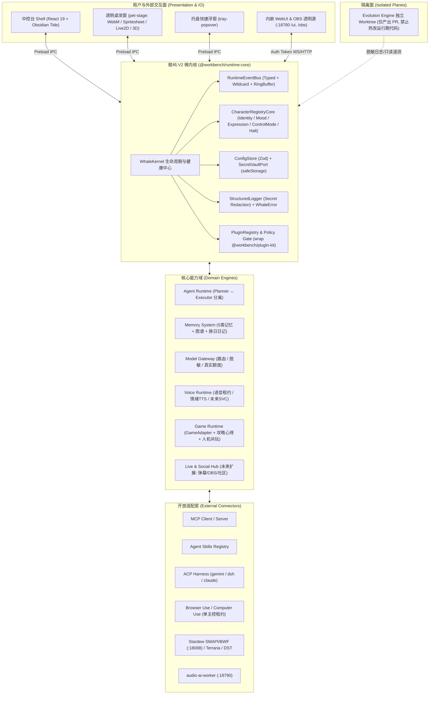
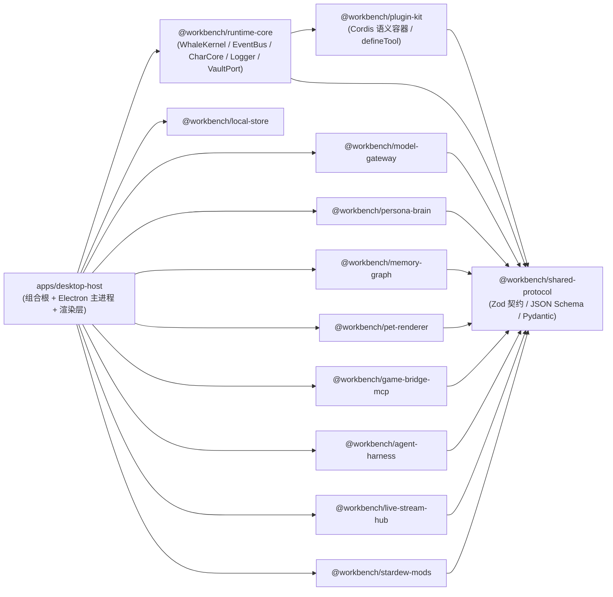
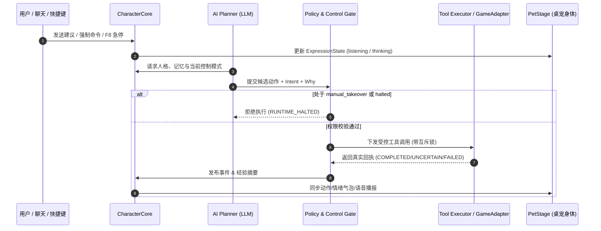

# Whale Isle V2 总体技术架构（任务 C）

> **核心定位**：AI 不只是聊天机器人，而是拥有统一数字身份、人格、记忆、情绪、声音、身体与行动能力的数字生命平台。  
> **演进方式**：基于现有 `whale-isle`（V1）采用绞杀者模式（Strangler Pattern）渐进重构，核心运行时与业务能力插件严格分离。

---

## 一、系统总体架构图

---

## 二、模块依赖关系图

> **依赖铁律（`dependency-cruiser` 机器强制）**：
> - `shared-protocol` 与 `runtime-core` 严禁依赖业务领域包（游戏、直播、渲染、UI）。
> - `apps/desktop-host/src/renderer/**` 严禁直接访问 SQLite、明文 Key 或外部大模型 API，所有外部调用经 `preload` → 主进程组合根完成。

---

## 三、十二大子系统架构设计

### 3.1 系统上下文与进程拓扑

- **Electron 主进程（Control Plane）**：唯一持有 `WhaleKernel`、SQLite、JSONL 记忆库、`safeStorage` 凭据库、模型网关、游戏 HTTP 桥与内置 WebUI/WS 服务器（`127.0.0.1:18780`）。
- **渲染进程（View Plane）**：`director`（中控台）、`pet-stage`（透明穿透桌宠窗）、`tray-popover`（托盘浮窗），全部运行在 `contextIsolation: true` 下，通过类型化 `preload` 桥通信。
- **外部 Sidecar / Mod 进程**：Python `audio-ai-worker`（`uv` 托管，`:18790`）、星露谷 BWF SMAPI Mod（`:18088`）、后续游戏 Sidecar。主进程通过超时控制与健康探针隔离其故障，Sidecar 崩溃不拖垮宿主。

### 3.2 模块边界与契约先行

- 所有跨进程、跨语言数据结构均在 `packages/shared-protocol`（及 `runtime-core` 契约）中以 Zod 定义，通过 `pnpm gen:contracts` 同步输出 JSON Schema 与 Python Pydantic 模型。
- **反幻觉铁律**：所有外部动作（游戏操作、语音播放、插件执行）均需返回结构化回执（`COMPLETED | IN_PROGRESS | UNCERTAIN | FAILED`），严禁将 LLM 文本宣称当作执行成功。

### 3.3 插件系统设计

- **内核层（`packages/runtime-core` + `packages/plugin-kit`）**：
  - 生命周期：`register` → `enable(setup)` → `disable(LIFO disposables)`，支持父子级联禁用与崩溃回滚。
  - **能力注入（Capability Injection）**：插件 `setup(api)` 仅能获得受作用域限制的 `logger`、子集 `events`、只读 `config`/`character` 快照、`defineTool` 与授权允许的 `petApi`。
  - **扩展点**：`sidebar.item`、`panel.route`、`aside.card`、`pet.animation`、`pet.line`、`overlay.widget`、`tool`。
  - **外部生态适配**：提供 `dsh` 插件适配器（`adaptDshPlugin`），并将 MCP、Agent Skills、ACP Harness、Browser Use 与 Computer Use 作为标准插件能力接入。

### 3.4 Agent Runtime 设计（规划与执行严格分离）

- **单一 Primary Runtime 先行**：第一阶段仅小鲸（`char_xiaojing`）运行完整的自主思考-规划-记忆闭环；其他桌宠以 `passive` 模式运行（仅形象、动画与基础交互）。
- **规划与执行分离**：AI Planner 仅产生结构化意图与工具参数，Tool Executor 负责白名单校验、动作互斥锁、超时看门狗与真实回执核验。

### 3.5 AI 角色与记忆系统设计

- **统一身份模型（`CharacterCore`）**：
  - `CharacterIdentity`（不可变 ID `char_xiaojing`、显示名、人设 ID、声线 ID、化身列表）完全独立于底层 LLM 模型、Harness 或当前皮肤。
  - `MoodState`（`valence`, `arousal`, `label`）为短期状态，不覆盖核心人格、不越权提升工具权限。
  - `ControlMode`（`autonomous` | `coop` | `command` | `manual_takeover`）与全局 `halted` 标志提供统一的控制权仲裁。
- **五类记忆架构**（基于 `packages/memory-graph` 演进）：
  - **Working**（短期对话与当前局内上下文）
  - **Episodic**（游戏回执、日常事件、换日日记）
  - **Semantic**（攻略知识库与经验心得 `StrategyNotebook`）
  - **Relational**（与主人、游戏 NPC、直播常客的好感与印象账本）
  - **Self**（自我认知、雷区偏好与成长摘要）
- **记忆治理**：每条记忆保留来源事件、重要度、置信度与 `pinned` 标志；支持用户查看、手动纠正与一键真删除（审计日志保留留痕）。

### 3.6 游戏 Agent 设计（第一阶段重点：星露谷物语）

- **集成方式**：采用 **SMAPI Mod（BlindWhaleFarmer HTTP/MCP + 自研 `WhaleIsleAvatar` 像素外观同步 Mod）**，避免 fragile 的纯图像识别操控。
- **自主与规则边界**：
  - 核心思考、目标设定、换季/赚钱/交友策略由 `LlmPlanner` 自主决定，参考 `guide-forager` 与 `StrategyNotebook` 经验但不死板照搬。
  - 确定性护栏仅兜底安全底线（动作互斥锁、防止 0 体力硬死、满包急救阶梯、离线无 Key 规则代驾、连续相同卡死自动停顿）。
- **人机协作控制阶梯**：`紧急停止 / F8` > `手动接管 / F9` > `强制命令 (/cmd)` > `协商目标` > `AI 自主目标` > `待机`。

### 3.7 桌宠状态联动设计

- **九态表现矩阵（`ExpressionState`）**：`idle`、`listening`、`thinking`、`speaking`、`singing`、`dancing`、`gaming`、`reacting`、`resting`。
- **渲染多态**：统一消费 `IPetAvatarRenderer` 接口，当前支持 `WebmVideoRenderer`（VP9-Alpha 双 `<video>` 零黑帧）、`SpritesheetRenderer`（WebP 精灵图）与 `PoseSkin`（CrossPet 静态立绘+特效），接口预留 Live2D 与 VRM-3D。
- **单端语音锁与唇形**：`AudioLeaseManager` 保证同一时刻最多一个音轨播放，P0 雷区反射可抢占打断，TTS 结束回执精确驱动桌宠气泡收起与动作恢复。

### 3.8 模型网关与真实额度查询设计

- **多供应商统一网关**：支持 OpenAI 兼容、Anthropic Messages 与 TypeSafe System One 协议；支持按槽位（主脑、内心戏、游戏规划、记忆提炼、弹幕、视觉复盘）路由与 100ms 内静默 failover。
- **四级诚实额度分类（绝不编造余额）**：
  1. **Official Verifiable API**：如 DeepSeek `/user/balance`、OpenRouter `/key`、OpenCode `/v1/usage`。
  2. **Verifiable 3rd-Party API**：带明确响应 Schema 校验的兼容端点。
  3. **CLI Readable Status**：本地 Harness（如 Codex/Claude/Gemini CLI）可解析的官方状态输出。
  4. **Unknown / Unverifiable**：明确展示 `未知 / 不可查询`，禁止估算或编造剩余额度。

### 3.9 统一事件总线设计（`RuntimeEventBus`）

- 所有核心域变更统一封装为 `RuntimeEventEnvelope<T>`（含单调递增 `seq`、UUID `id`、标准命名 `domain:action`、`source`、`characterId`、`timestamp`、`payload`）。
- 支持精确订阅、`domain:*` 尾通配、`*` 全监听、`once` 自动注销、异常隔离（单个监听崩溃不影响其余监听）与有界环形历史（支持渲染窗刷新水合与 WebUI 晚连回放）。

### 3.10 数据存储方案

| 数据类型 | V2 目标引擎 | 存储位置 | 生命周期与安全 |
| --- | --- | --- | --- |
| **V2 内核配置** | Zod 校验 JSON（原子写） | `userData/v2-runtime-config.json` | 损坏自动安全回退默认值 |
| **UI 偏好与供应商目录** | Dexie (IndexedDB) | 渲染进程 | 与主进程网关按配置同步 |
| **API Key 与平台凭据** | Electron `safeStorage` | `userData/provider-vault.json` | 明文仅主进程内存瞬间存在，v2 身份隔离 |
| **结构化账本（友谊/常客/资产注册/点歌缓存）** | `node:sqlite` (统一收敛) | `userData/*.sqlite` | 支持按角色隔离与一键隐私擦除 |
| **记忆图谱 / Token 流水 / 审计日志** | JSONL Append-Only | `userData/memory/`, `meter/` | 墓碑压实，不可篡改审计流 |

### 3.11 安全、权限与治理设计

- **P0–P5 权限阶梯**：
  - `P0` 读本地非敏感状态（自动放行）
  - `P1` 读公开/已授权外部内容
  - `P2` 生成本地草稿/资产候选
  - `P3` 可撤销本地变更（需规则或会话授权）
  - `P4` 对外互动/发布（默认必须人类确认）
  - `P5` 私信/删数/支付/敏感凭据（每次显式确认；插件清单声明 `vault://*` 或 `shell://*` 硬拒）
- **Computer Use 单主控锁**：同一主机同一时间只允许一个 Agent 持有桌面键鼠控制租约（`ControlLease`），支持硬件级/全局快捷键随时强制收回。
- **双平面隔离（Runtime Plane vs Evolution Plane）**：线上运行的小鲸严禁自修改生产代码或执行未受控 Shell；未来 Evolution Engine 仅在独立 Git Worktree 运行测试并提交 PR，需审核通过后才可灰度发布。

### 3.12 多设备扩展设计（架构预留）

- 通过 `DeviceRegistry`（`deviceId`, `hostName`, `capabilities`: desktop/game/browser/gpu）与 `ControlLease`（租约持有者、心跳、TTL、自动释放）为跨设备游戏协作（例如 PC 跑星露谷 + Mac 跑桌面陪玩与中控台）预留协议接口；底层传输复用带设备 Token 鉴权的 WebSocket 事件总线镜像。
