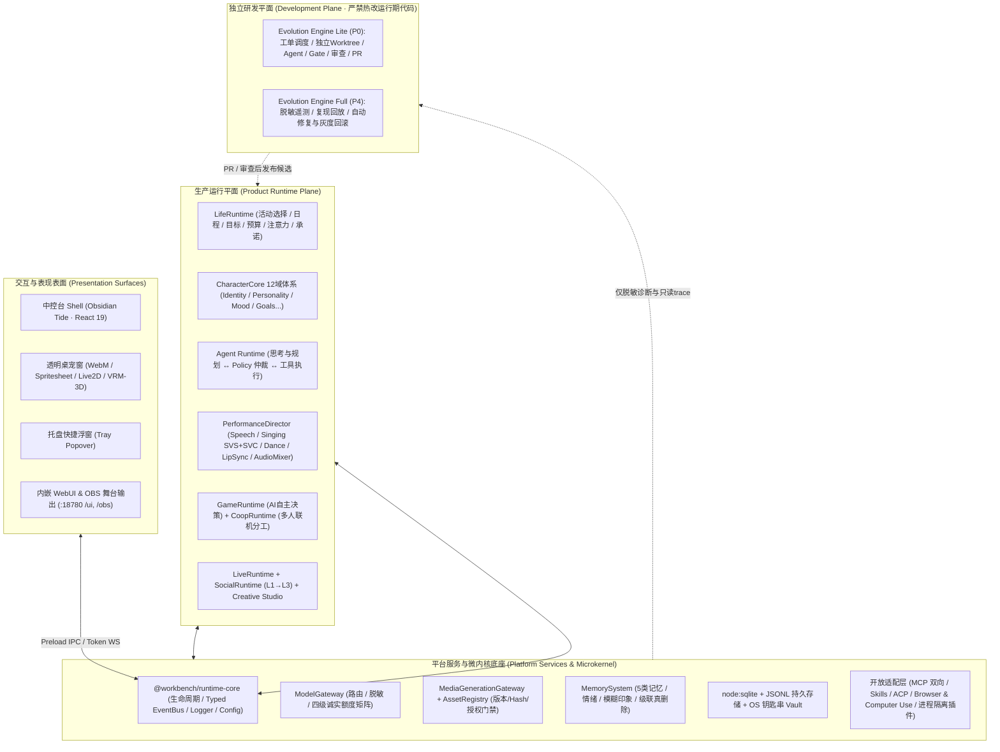
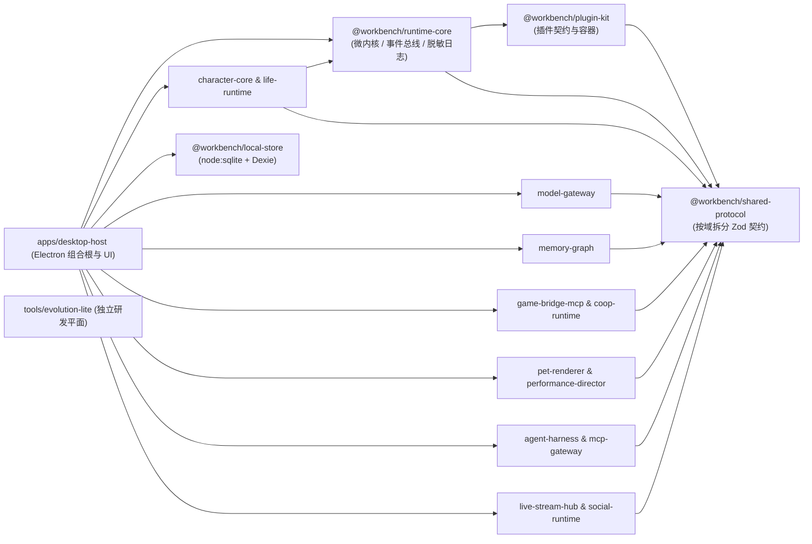
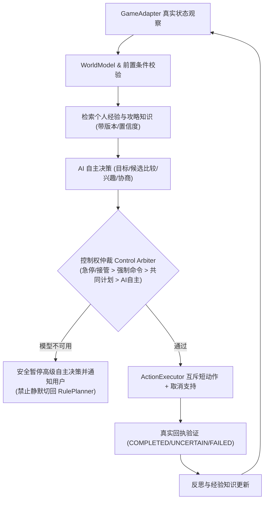
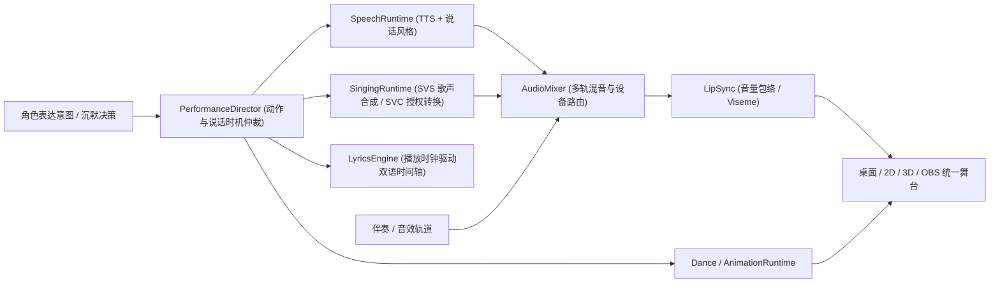

# Whale Isle V2 总体技术架构（修订版 · v2.1）

> **上游依据**：[blueprint/](./blueprint/README.md)（01–17 + MASTER）、用户第一轮架构审查反馈、[ADR-000](./adr/ADR-000-product-charter-and-risks.md)、[ADR-001](./adr/ADR-001-v2-foundation.md)、[ADR-002](./adr/ADR-002-v2-architecture-revision.md)。  
> **核心理念**：AI 不只是聊天机器人，而是一个拥有统一数字身份、人格、记忆、情绪、声音、身体和自主生活能力的数字生命平台。  
> **架构原则**：Modular Monolith + 独立 Worker 起步；**先用一个主 AI 角色（小鲸 `char_xiaojing`）跑通全量产品闭环**；生产运行平面与 Evolution 研发平面严格物理隔离。

### 核心概念解耦边界（来自 [03-领域模型与数据契约](./blueprint/03-%E9%A2%86%E5%9F%9F%E6%A8%A1%E5%9E%8B%E4%B8%8E%E6%95%B0%E6%8D%AE%E5%A5%91%E7%BA%A6.md)）
- **`Character`**（稳定数字身份，如主角色 **小鲸** `char_xiaojing`） ≠ **`AgentRuntime`**（`primary` / `worker` / `passive` 执行态） ≠ **`ModelProvider`**（LLM / 生图 / 语音后端） ≠ **`Harness`**（Codex / Claude / Gemini 等外部框架） ≠ **`Embodiment`**（`desktop-2d` / `live2d` / `vrm-3d` / `game` / `stage`） ≠ **`Device`** ≠ **`SocialAccountBinding`** ≠ **`AssetVersion`** ≠ **`MemoryRecord`**。
- **硬规则**：更换模型不创建新 Character；更换桌宠外观不创建新 Agent；同一 Character 可同时映射多个 Embodiment；第一阶段仅维护一个 `primary` AgentRuntime，其余桌宠为 `passive`；**Plugin**（安装/隔离单位）、**Skill**（任务知识包）、**MCP Server**、**Tool** 与 **Harness Adapter** 五者概念严格区分。

---

## 一、三平面总体架构（Three-Plane Architecture）

---

## 二、模块依赖与边界治理

**反腐败与防漂移红线**：
1. 禁止把 `WhaleKernel` 做成新的 God Object：内核只托管生命周期、插件容器、事件总线、配置/凭据接口与分级日志；角色逻辑、生活调度、游戏规划留在各自独立包中。
2. 禁止新旧双写状态长期并存：每个 Strangler 重构工单必须明确**唯一事实源归属、兼容适配期、旧代码退役条件与回滚方案**。
3. 禁止用 `EventBus` 替代强契约接口：查询与需要强一致性结果的动作走明确 Typed Service 接口，事件仅广播已发生事实。
4. 禁止把内存 `RingBuffer` 误当持久事件存储：需要跨会话保留的诊断与审计事件必须追加落盘（JSONL / SQLite）。
5. `shared-protocol` 随领域增长按域文件拆分（`character.ts`、`game.ts`、`voice.ts`、`asset.ts`、`quota.ts`、`coop.ts`），保持单文件可读性。

---

## 三、`LifeRuntime` 与 `CharacterCore` 12 域模型

### 3.1 `LifeRuntime`（数字生活运行时）
- **定位**：角色统一的日常生命协调器。游戏、直播、社区、创作、学习与桌面陪伴都是角色下的能力活动，而非各自拥有独立大脑。
- **核心职责**：
  1. **自主活动选择与日程**：结合角色兴趣、时段、用户勿扰设置与近期经历决定当前活动。
  2. **多时间尺度目标与承诺**：协调长期愿望、当日计划、实时动作及与用户/他人的约定。
  3. **注意力与上下文切换**：处理活动中断、暂停、恢复（例如从游戏切去回应重要消息后再回游戏）。
  4. **资源与预算约束**：受每日 Token 饭碗、设备负载、网络与用户授权限制，拒绝无意义死循环。

### 3.2 `CharacterCore` 12 域数据所有权矩阵

为防止 `CharacterCore` 演变为巨型单类，将 12 个域按所有权拆分为协作的轻量模块，以不可变 `characterId`（第一阶段主角色 `char_xiaojing`）串联全平台：

| 域 | 职责与演进规则 | 权威存储归属 |
| --- | --- | --- |
| **1. Identity** | `characterId`、名称、角色类型（`primary`/`passive`）、基础设定引用 | `CharacterRegistry` |
| **2. Personality** | 稳定特质（好奇、傲娇、耐心等）与行为红线，随重大经历微调 | `PersonaProfileStore` |
| **3. Preferences** | 对游戏、音乐、话题、玩法的长期喜好，保留变化来源 | `PreferenceStore` |
| **4. Emotion** | 短期 `valence / arousal / label` 情绪状态，**严禁提升工具权限** | `EmotionStateEngine` |
| **5. Motivation** | 当前驱动力（好奇探索 / 陪伴主人 / 达成某目标） | `LifeRuntime` |
| **6. Goals** | 当前动作 / 短期 / 阶段 / 长期 / 共同目标栈 | `GoalManager` |
| **7. Commitments** | 与主人或联机伙伴达成的约定（如“先去矿洞再钓鱼”） | `CommitmentLedger` |
| **8. Relationships** | 与主人、NPC、直播常客、其他角色的关系及边界 | `local-store` / `memory-graph` |
| **9. Memory** | 五类记忆与个人经历索引（含模糊印象与真删除级联） | `MemorySystem` |
| **10. Voice Identity** | 独立声线、语言习惯、说话风格与唱歌风格（与具体 TTS 解耦） | `VoiceProfileStore` |
| **11. Embodiment** | 桌面 2D/Live2D/VRM、游戏像素化身、舞台槽位映射 | `EmbodimentRegistry` |
| **12. Activity State** | 当前活跃模式（闲聊/游戏/直播/创作/安静休息）与控制权租约 | `LifeRuntime` + Control Arbiter |

---

## 四、AI 自主游戏架构与 `CoopRuntime` 多人联机

### 4.1 AI-First 游戏智能（绝对禁止硬编码情景策略）

- **职责硬边界**：程序层只提供可靠观察、寻路、动作执行、前置条件检查、超时取消、过期指令拒绝（`sessionId`/`generation`）与真实回执验证；**一切策略选择（满包处理、天气响应、体力分配、采矿/钓鱼/种田切换）必须由 AI 结合实时状态、目标与知识自主决定**。
- **`RulePlanner` 定位**：仅保留给确定性单元测试、协议兼容性回归或用户显式手动启用；**LLM 故障/缺 Key 时默认暂停自主决策，绝不未经用户同意静默切换为规则机器人**。
- **攻略学习闭环**：每条游戏知识记录 `sourceType`、`gameVersion`、`modContext`、`applicability`、`confidence` 与 `verificationStatus`，作为参考依据而非强制指令。

### 4.2 多人游戏与协作架构（`CoopRuntime`）

真正的多人协作独立于跨设备同步，支持：
1. **同机多 AI 游戏角色**（多实例/Mod 分身路由与各自控制权）；
2. **多机联机同一世界**（多设备上的不同 AI 加入同一联机房间）；
3. **人机联机共玩**（用户与 AI 分别操作各自游戏角色共同探索、分工）；
4. **协作与冲突解决**：`SharedGoal`、`CoopTaskBoard`、农场箱子/作物 `ResourceReservation`、任务交接、**联机客户端 Mod/自定义外观兼容性预检**（不假设本机像素替换自动同步至其他玩家）、断线重连与状态恢复。

### 4.3 四种控制模式、六级控制优先级与三层控制权租约（严格分离）

1. **四种游戏控制模式**（来自 [17-自主游戏智能](./blueprint/17-%E8%87%AA%E4%B8%BB%E6%B8%B8%E6%88%8F%E6%99%BA%E8%83%BD%E4%B8%8E%E4%BA%BA%E6%9C%BA%E5%85%B1%E7%8E%A9%E7%B3%BB%E7%BB%9F.md) §9）：`Autonomous Mode`（AI 自主决策）、`Collaborative Mode`（双方围绕共同目标协商）、`Direct Command Mode`（优先完成明确任务指令）、`Manual Takeover`（人类直接接管，AI 停止写入控制动作）。
2. **六级控制优先级（高 → 低）**：`① 急停 / 手动接管 / 用户物理键鼠输入` > `② 明确强制命令` > `③ 直接任务指令` > `④ 双方共同计划` > `⑤ AI 自主目标` > `⑥ 默认待机`（普通建议纳入评估但可被 AI 有理有据婉拒；出售稀有物/高消耗等高影响不可逆操作支持二次确认）。
3. **三层控制权租约模型**：
   - **设备级 `ComputerUseLease`**：同一主机同一时刻仅允许一个前台自动化控制者，用户键鼠输入立即夺回。
   - **游戏角色级 `GameCharacterControlLease`**：绑定至具体 `gameInstanceId + playerRoleId`，支持 `Stop / Pause / Takeover / Release`、在飞动作即时 `cancel_action` 与过期指令拒绝（`sessionId` / `generation`）。
   - **角色活动级 `LifeActivityAuthority`**：由 `LifeRuntime` 裁决角色当前是专注于游戏、切换去回消息，还是进入休息。

---

## 五、统一声音、唱歌、舞蹈与表演系统

- **解耦单音轨瓶颈**：将 V1 的 `AudioLeaseManager` 升级为 **Speech Floor（说话发言权，防止同时说两句话）+ Performance Session + Audio Device Routing + Multi-Track `AudioMixer`**，确保角色说话/唱歌时伴奏、游戏音效与后续合唱不会互相阻塞。
- **TTS / SVS / SVC 严禁混为一谈**：普通 TTS 只负责自然对话；唱歌由 `SingingRuntime` 明确区分歌声合成（SVS：歌词+旋律）与歌声转换（SVC：授权音色转换），且均须经过歌曲、伴奏与歌词授权门禁。
- **自然感与沉默权**：角色有权在陪伴或专注时保持沉默；桌宠气泡展示可读意图与简短行动理由，不依赖隐藏思维链。

---

## 六、完整 `Creative Studio` 与资产管线

- **`MediaGenerationGateway`**：统一任务排队、进度、预算与失败重试，解耦生图/3D/音频引擎：
  - **图片生成**：接入本地具备图像能力的 Coding Agent（如 Codex）或在线图片模型 API；
  - **3D 生成**：优先调用 3D 生成大模型（如 Hunyuan3D）产出网格与材质，**Blender 专职自动化后处理（法线、UV、减面、骨骼绑定、BlendShapes、VRM 导出与 QA）**。
- **Character Bible 与全流程工作室**：
  - 统一三视图、配色、特征约束，确保跨桌面、2D/Live2D、3D VRM 与星露谷像素化身一致性；
  - 覆盖 Character Design / 2D & CrossPet 全量合法导入 / 3D & VRM / Animation / Game Pixel & `stardew-avatar-sync` 导出真机验证 / Scene & Voice 创作；
  - **十态 `AssetRegistry`**：`draft → generating → candidate → processing → validation_failed | review_required → approved → published → deprecated / restricted`，强制记录来源、Hash 与许可范围，非商用资产进入商用/直播上下文即拦截。

---

## 七、直播、社区数字生活（L1–L3）与记忆增长

- **LiveRuntime**：由 `LifeRuntime` 按意愿与授权调度开播；弹幕经去重、过滤、合并与三级注意力调度避免压垮大模型；逐平台核对官方 API 许可。
- **Social Digital Life 三阶段演进**：
  - **L1（只读学习）**：自主浏览感兴趣内容、理解吸收并更新兴趣与记忆；
  - **L2（草稿审核）**：生成评论、回复或作品草稿，经用户确认后执行；
  - **L3（受限自主）**：在平台官方规则与用户明确白名单授权范围内自主互动与维护关系。
  - 每个角色独立账号与独立 Browser Profile；绝不绕过验证码、访问控制或反自动化限制。
- **类人五类记忆**：保留 `Working / Episodic / Semantic / Relational / Self`，引入情绪关联权重、模糊印象归纳、主动回忆巩固与自然衰减；**区分自然遗忘与用户主动删除**（主动删除须同步擦除衍生摘要与索引并保留不可删除的删除审计）。

---

## 八、模型供应商与四级诚实额度矩阵

- 支持供应商：**DeepSeek、MiniMax、Kimi（Moonshot）、OpenCode（Go/Console）、OpenRouter、OpenAI/Anthropic 兼容、TypeSafe Jev、Ollama/本地引擎**；参考 Magpie / Pi / 成熟 Harness 的路由、脱敏与本地探测机制。
- **额度查询精细模型**：
  - **维度**：账户余额、5 小时窗口配额、周额度、月额度、剩余 Token、请求次数、套餐权益、重置时间；
  - **元信息**：`source`（`official_api` | `verifiable_third_party` | `cli_status` | `unknown`）、`fetchedAt`、`scope`、`authState`、`errorDetail`；
  - **诚实铁律**：未经实测可用的接口严禁编造余额，统一标为 `未知 / 不可查询`。

---

## 九、安全边界、权限分级、插件隔离与 `Evolution Engine`

- **P0–P5 权限阶梯与数据分类**（来自 [11-安全隐私权限与治理](./blueprint/11-%E5%AE%89%E5%85%A8%E9%9A%90%E7%A7%81%E6%9D%83%E9%99%90%E4%B8%8E%E6%B2%BB%E7%90%86.md)）：
  - **权限等级**：`P0` 读取本地非敏感状态（可授权自动）→ `P1` 读取公开/已授权内容 → `P2` 生成草稿/计划/预览（自动）→ `P3` 可撤销本地变更（按规则授权）→ `P4` 对外评论/发布/关注/互动（默认确认或有限白名单）→ `P5` 私信/删除/账号安全设置/支付/出售稀有游戏物品（每次明确确认）；**用户授权绝不能覆盖平台禁止规则**。
  - **7 类数据分级**：`Public`、`User Content`、`Character Private`、`Account Secret`（只存引用与钥匙串，Cookie 禁入普通 JSON）、`Live Audience Data`、`Runtime Diagnostics`、`Development Artifacts`（研发平面只接收脱敏最小诊断集）。
- **插件真实隔离**：
  - 内置可信插件运行于受控内核上下文；
  - **第三方不可信插件**运行在独立 Worker/子进程沙箱中，所有文件、网络、系统与账号调用经主进程 Policy Broker 真实拦截校验（`vault://*` / `shell://*` 硬拒）。
- **Evolution Engine 双阶段架构**：
  - **Lite（P0/P1）**：`tools/evolution-lite` —— 唯一工单状态机、生产仓库外独立 Git Worktree 隔离、Coding Agent CLI 适配器、自动化门禁运行器、独立 Diff/安全审查器、PR 草案与失败停机报告、跨会话进度恢复；
  - **Full（P4）**：接入生产脱敏诊断遥测、问题自动复现回放、优化提案、低风险策略自动合并与灰度回滚。
  - **不可逾越铁律**：运行中的小鲸可提交脱敏反馈，但**严禁直接修改生产工作目录源码、篡改自身权限或跳过质量门禁**。
