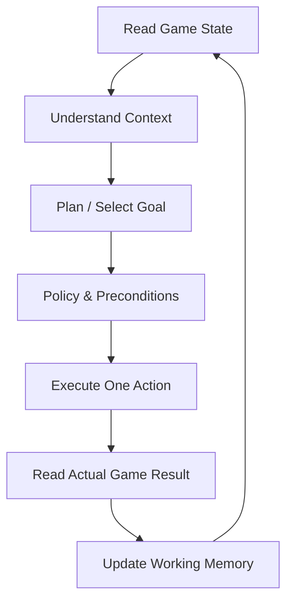

# 07 --- 游戏化身、星露谷 Mod 与多人协作

## 1. 目标

桌宠与游戏中的角色是同一个 Character 的不同
Embodiment。游戏角色应尽可能像桌宠，但必须符合目标游戏的美术风格和素材规格。

## 2. 三个游戏化身等级

### Level 1：玩家外观替换

将主角色的像素素材映射到当前玩家角色。现有 `mods/stardew-avatar-sync`
是这一层的基础。

### Level 2：AI 专属 NPC

AI 可以作为独立 NPC
出现在游戏中，拥有肖像、对话、日程和行为。需要遵循游戏 Mod API
和多人兼容要求。

### Level 3：完整可控游戏化身

多个 AI 角色在游戏中各自拥有身份和可控角色，可以协作、分工、参加活动。

第一阶段先完成 Level 1，验证稳定后再逐步做 Level 2/3。

## 3. 现有仓库基础（需复核）

此前检查到 `mods/stardew-avatar-sync/`，面向 SMAPI 4.x / Stardew Valley
1.6，有 `active-avatar.json` 形象切换、Sprite Sheet
帧布局、预设和自定义素材、运行时监听素材更新以及 Harmony Patch
相关路径。

这些是初步审查记录，实施前必须再次核对当前分支、代码和真实游戏运行结果。

## 4. Mod 技术路线

### Content Patcher

适合静态内容：肖像、纹理、NPC 资源、物品和
UI，以及不需要动态运行逻辑的内容。

### Whale Isle SMAPI Mod

适合动态能力：角色形象热切换、Agent
状态同步、情绪/动作表现、游戏状态回传、多角色 ID
映射，以及通过受控协议接收动作指令。

优先使用 SMAPI 公开 API。Harmony Patch 只在必要且经过兼容测试时使用。

## 5. Game Adapter 协议

``` ts
interface GameAdapter {
  gameId: string;
  detectInstallation(): Promise<GameInstallInfo[]>;
  getCapabilities(): Promise<GameCapability[]>;
  connect(instanceId: string): Promise<void>;
  getState(): Promise<GameState>;
  executeAction(action: GameAction): Promise<GameActionResult>;
  installEmbodiment(packId: string): Promise<InstallResult>;
  validateCompatibility(): Promise<CompatibilityReport>;
}
```

游戏控制动作必须有前置条件、目标、超时、幂等策略、结果回执、失败原因、重试策略和可撤销性说明。

## 6. 游戏 Agent Loop



不能让模型只发出动作就认为成功。必须读取真实游戏状态或 Mod 回执确认。

## 7. 星露谷协作

分工示例： - 用户：探索、钓鱼、社交、采矿； -
AI：播种、浇水、收获、整理、补充物资； -
共同目标：完成社区中心、升级工具、规划农场。

协作系统需要 Shared Goal、Task Board、Resource
Reservation、Ownership、Conflict Resolution、Progress Report、Handoff 和
Failure Recovery。

``` ts
interface CoopTask {
  taskId: string;
  roomId: string;
  ownerId: string;
  goal: string;
  preconditions: string[];
  resourceLocks: string[];
  status: "proposed" | "accepted" | "running" | "blocked" | "completed" | "failed";
  result?: string;
}
```

重要资源需要锁定或确认。AI 不应把用户计划保留的作物卖掉。

## 8. 多设备多人游戏

每台设备有独立 Game Node：游戏实例、Mod 版本、Asset Pack
版本、玩家映射、Agent Runtime 所属和连接状态。

进入多人游戏前检查 Mod 版本、资产 Hash、游戏版本、依赖和兼容性。

如果某个客户端没有对应
Mod，其他玩家不一定能看到自定义形象。不能假设本机替换会自动同步到所有客户端。

## 9. Game Asset Pack

``` text
character/game/stardew/
├── farmer/
│   ├── sprites.png
│   ├── portrait.png
│   └── animation-map.json
├── npc/
├── expressions/
├── manifest.json
└── provenance.json
```

manifest 包含目标游戏版本、Mod 依赖、Sprite Sheet
布局、帧尺寸、方向、动画名称、角色 ID、资源 Hash 和许可证信息。

## 10. 多游戏扩展

未来可研究 Terraria/tModLoader、Minecraft/Fabric/NeoForge、Don't Starve
Together 等具有官方或成熟 Mod API 的游戏。不要把星露谷专用逻辑写进 Agent
Core。每款游戏只实现 Game Adapter。

## 11. 验收

-   主角色外观稳定映射到游戏；
-   游戏切换形象后桌宠与游戏状态一致；
-   AI 动作有真实回执；
-   人机协作有任务分工和资源冲突处理；
-   多设备加入前执行兼容检查；
-   Mod 崩溃不会破坏桌宠主程序；
-   游戏更新后有兼容性检测和回退策略。

## V2.1 增补：自主决策与人机共玩

星露谷 Agent 不应依赖“背包满了就回家”“下雨天就钓鱼”这类固定情景规则。它应观察真实游戏状态，自主提出目标、比较方案、执行短动作并验证结果。例如背包满时，它可以评估是否制作箱子、存放物品、整理或调整当前计划；是否钓鱼、下矿或探索，应由当前状态、兴趣、资源、目标和新机会共同决定。

Agent 应能学习 Wiki、攻略、玩家经验、Mod 文档和自己的游戏经历。知识需带游戏版本、Mod 条件、来源、置信度和验证状态；攻略是参考而不是命令，必须结合当前存档情况灵活应用。

用户可在游戏中通过聊天和 AI 像朋友一样讨论下一步。建议与明确指令必须区分：AI 可以不同意普通建议，但应优先执行明确任务；Stop、Pause、Take Over 等快捷命令能立即改变控制权。完整控制模型、知识模型、架构组件和验收用例见 `17-自主游戏智能与人机共玩系统.md`。
